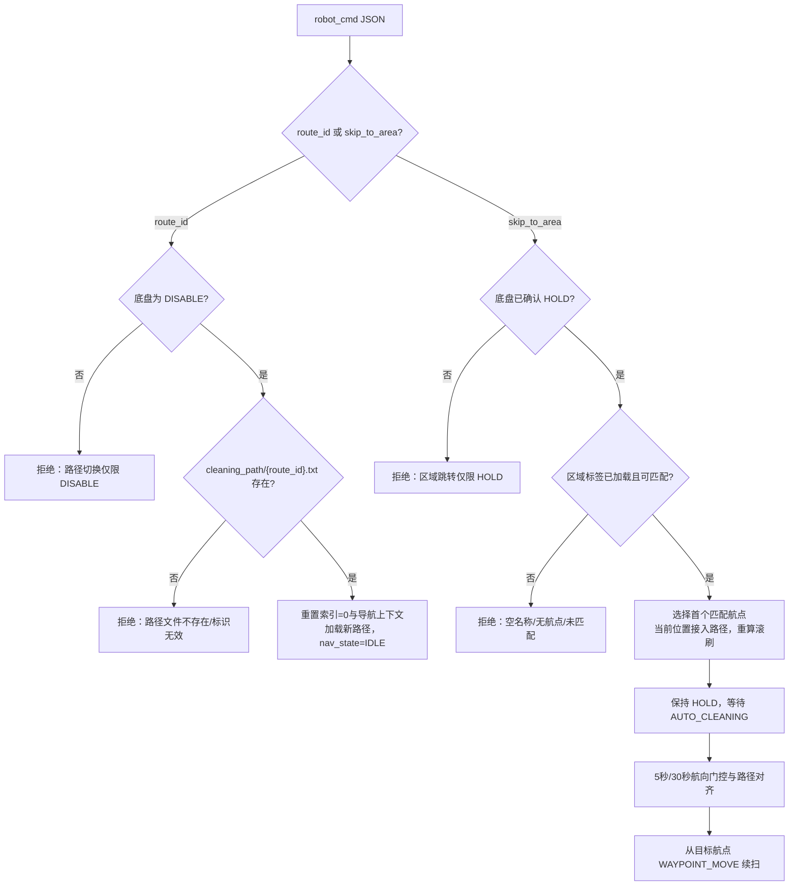
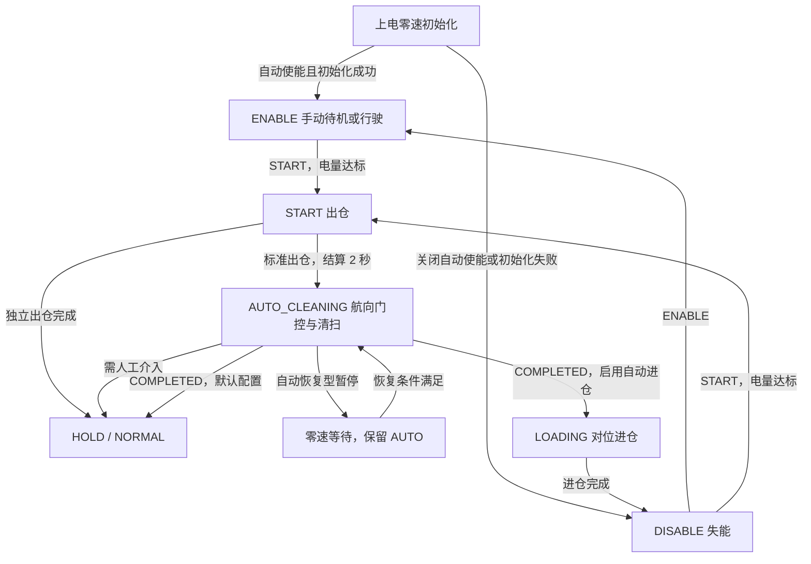

# RTK 循迹 ROS2

ROS2 Jazzy 室外清扫系统。`motor_control` 管理底盘状态、进出仓和电机保护，`rtk_nav` 管理航点跟踪和自动清扫时的滚刷指令。整机默认使用 AIMotor 驱动左右轮，步科 Kinco iSMK 驱动两台滚刷。

## 启动与测试

先配置设备对应的路径、串口和 `robot_ID`，并初始化 CAN 接口。整机默认启用 `wtrtk_serial_driver` 接收实时 RTK。离线回放使用 `wtrtk_parse_txt`，由回放节点单独提供 RTK 数据。

```bash
colcon build --symlink-install
source install/setup.bash
ros2 launch rtk_nav run.launch.py
```

仅测清扫、完成后停在 `HOLD` 时使用 `auto_cleaning_finish_to_loading:=false`（整机默认值）。独立运行 `motor_control` 时，此参数默认 `true`，测试时需显式关闭。若有配置返仓航点，RTK 仍会先导航到该航点，然后发出 `COMPLETED`。

室内无 RTK 时可通过 `enable_brush_test:=true` 测试手动滚刷。在其他启停条件满足时，滚刷在手动待机、行驶、遥控或 MQTT 轮速 `HOLD` 中保持测试转速。键盘 `h`、显式失能、进出仓和保护停机优先。进入 RTK 自动模式后由 `rtk_nav` 接管。

```bash
ros2 launch rtk_nav run.launch.py enable_brush_test:=true
```

键盘指令通过 `/keyboard/control` 发布。例如下面的 `r` 请求进入 RTK 导航。`n` 和兼容指令 `m` 切回 `NORMAL`，`w/s/a/d` 控制手动行驶，`x` 请求使能，`h` 停车，`z` 请求失能。

```bash
ros2 topic pub /keyboard/control std_msgs/msg/String "{data: 'r'}" -1
```

## 路径切换与区域跳转

路径标识 `route_id` 是清扫路径文件的文件名去掉 `.txt` 后缀，例如
`008-W19-W16` 对应 `cleaning_path/008-W19-W16.txt`。`rtk_nav` 通过
`/rtk/current_route_id` 发布当前实际加载的标识，`motor_control` 将其同步到
`/robot_state` 的 `route_id` 字段；它不是单纯的显示字段，而是当前导航文件的标识。

### 修改 `route_id`（切换整条路径）

通过 `robot_cmd` 发送下列任一 JSON；`route_id` 不带 `.txt` 后缀：

```bash
ros2 topic pub /robot_cmd std_msgs/msg/String \
  '{data: "{\"route_id\":\"008-W19-W16\"}"}' -1

# 兼容写法
ros2 topic pub /robot_cmd std_msgs/msg/String \
  '{data: "{\"command\":\"CHANGE_ROUTE\",\"route_id\":\"008-W19-W16\"}"}' -1
```

限制条件：

- 仅在底盘状态为 `DISABLE` 时受理；`ENABLE`、`HOLD`、`START`、`LOADING` 和 `AUTO_CLEANING` 均会拒绝。
- 文件必须存在于设备配置的 `cleaning_path/{route_id}.txt`；不存在、空 `route_id` 或带错后缀（如传入 `xxx.txt`）不会切换。
- 成功后导航节点清空旧航点、滚刷事件、校准/边界/force-bearing 上下文和航向异常计时器，将航点索引置为 `0`、导航状态置为 `IDLE`，再加载新文件并发布新的 `route_id`。
- 切换路径不自动启动清扫；标准作业流程是随后下发 `START`，出仓结算后进入 `AUTO_CLEANING` 航向门控。

### 公共首点接入区域

不同路线可共用现场标定的安全区域。将 `common_entry_area.fence.json` 放在
`cleaning_path` 路径目录，或启动时通过 `geofence_entry_area_path:=绝对路径` 指定。
文件使用与路线 `.fence.json` 相同的 UTM 分带，`areas` 包含一个或多个严格凸多边形，
每个 `boundary_utm` 按顺时针或逆时针顺序列出车体中心允许到达的边界点：

```json
{
  "utm_zone": [49, "S"],
  "areas": [
    {"name": "entry", "boundary_utm": [[1, 1], [2, 1], [2, 2], [1, 2]]}
  ]
}
```

上面的坐标仅说明格式，不是现场可使用的标定数据。应按车体尺寸、定位误差、制动距离
和障碍物留出安全余量；凹形区域可拆分为多个凸多边形，不得覆盖障碍物或禁行区域。
显式指定的文件缺失、分带不同或多边形无效时拒绝自动导航。未指定且默认文件不存在时，
保留原路线围栏行为。首点接入前检查当前位置至首点的直线全程在允许区域内，不能直达时
停车，不会自动绕行。首点接入比较前进与倒车的航向转角并选择较小者；到达首点后再按航点航向校准，且不再将公共区域作为正常清扫的围栏扩展。

自动导航中越界时先停车并锁存 `1024`，下次明确进入 AUTO 才尝试回边。回边要求已标定
区域覆盖回边路径、双 Fixed、新鲜 IO 和停车反馈；滚刷关闭，最多移动 2 米、持续 90 秒。
连续 3 个新可信位置在允许区域内且停稳后才恢复当前航点；条件不满足时继续停车。
首次使用前须在现场复核边界并受控测试，位置和传感器无法替代障碍物检测。

路线 `.fence.json` 支持分别设置 `area_expansion_radius_m` 和
`bridge_expansion_radius_m`。当前密集路径规划器使用清扫区域 `0.6 m`、桥架走廊
`0.3 m`；桥架折点同时生成圆角连接区，避免分段矩形之间出现几何缺口。旧文件只有
`expansion_radius_m` 时仍按该值同时兼容清扫区域和桥架走廊。

### `skip_to_area`（从指定区域续扫）

区域跳转仅接受如下 JSON：

```bash
ros2 topic pub /robot_cmd std_msgs/msg/String \
  '{data: "{\"skip_to_area\":\"bridge_E3out2-E3\"}"}' -1
```

限制与行为：

- 命令入口与 `rtk_nav` 接收端均要求底盘已确认处于 `HOLD`；任何一个检查发现不是 `HOLD` 都会拒绝。不要在 `AUTO_CLEANING` 行驶时直接跳转。
- 区域名不能为空，且当前路径必须已加载航点及区域标签；否则不改变索引。
- 匹配优先级为**精确匹配**、**前缀匹配**（`area.startswith(target)`）、**双向包含匹配**。匹配到多个不同区域时，按路径文件中的先后顺序选择第一个，并在日志中列出候选区域；因此应优先传完整区域名，避免依赖前缀/包含匹配。
- 跳转到匹配区域的首个航点。若当前位置有效，以当前位置建立接入航段；否则回退使用目标航点的前一航点（首航点则使用自身）。旧 Stanley 路径方向不会沿用。
- 跳转会重置校准、边界撤退和 force-bearing 上下文，清除错误码 `128`，并按目标航点索引重新计算滚刷状态；跳入 `#start` 与 `#stop` 之间时滚刷会在恢复 AUTO 后开启。
- 跳转完成时 `rtk_nav` 会发布计划恢复状态 `WAYPOINT_MOVE`，但底盘仍处于 `HOLD`，不会运动。随后重新进入 `AUTO_CLEANING`，仍必须通过 5 秒/30 秒航向门控并完成必要的路径对齐，才从目标航点开始行驶。




## 无线充电
### 开始充电

ros2 service call /start_charging custom_msgs/srv/ChargeControl "{}"

### 停止充电
ros2 service call /stop_charging custom_msgs/srv/ChargeControl "{}"

### 查询电压电流
ros2 service call /query_volt_curr std_srvs/srv/Trigger "{}"

### 实时订阅故障码话题
ros2 topic echo /charging_fault_code std_msgs/msg/Int16


## 底盘状态机与 RTK 作业



- `motor_auto_enable=true` 时，底盘启动后进入 `ENABLE`，步科滚刷完成初始化并保持失能。`ENABLE` 和 `START` 仅主动使能 AIMotor，步科在接到有效运行指令后按需使能。磁导航确认已在仓时，`ENABLE` 会经进仓完成流程转为 `DISABLE`。
- `START` 和独立 `UNLOADING` 共用出仓前进流程。起步经过满位 T 型磁条时采用基础轮速，沿纵向磁条行驶时按磁偏差纠偏，驶出磁条后恢复基础轮速，直至从出仓起步计时达到 14 秒。`unloading_use_magnetic_navigation:=false` 时全程采用基础轮速。独立出仓结算后保持 `HOLD`。
- `HOLD` 用于停车、接管和续扫准备。Web `MANUAL` 是独占手动控制入口，MQTT `RC_ENABLE` 用于遥控器接管。切回自动模式后，`rtk_nav` 重新检查航向门控与接入航段。
- `rtk_nav` 经 `/rtk/nav_state` 发送带 `pause_reason`、`auto_resume`、递增 `seq` 的 JSON。底盘丢弃旧序号。`auto_resume=true` 保持 `AUTO_CLEANING` 并停车，`auto_resume=false` 切换到 `HOLD/NORMAL`，等待人工重新进入 AUTO。
- 底盘仅在仍为 AUTO 且未进入出仓或进仓流程时处理 `COMPLETED`。导航在完成和模式切换时清理上下文，周期重复的非 AUTO 消息只维持停车，避免反复重置和刷屏。

### RTK 执行流程

1. **进入 AUTO**。停车等待定位 Fixed、定向 Fixed 和有效 GGA，通过 5 秒短窗与 30 秒收敛窗，两者航向波动上限均为 1°。需要接入既有航段时先做航向对齐。
2. **巡迹与到点**。`INITIAL_MOVE` 接近首点，`WAYPOINT_MOVE` 跟踪后续航段。进入 0.10 m 范围后先停车，首点需要连续 5 个新可信定位样本，普通点需要 3 个。确认到点后进入 `WAYPOINT_CALIB`，达到目标航向精度再推进索引。切点、恢复和重建航段时同步清理或重算 Stanley 起点及方向。
3. **定位异常与恢复**。导航用 GGA 原始时间戳识别重复和乱序样本，定位跳变时保留可信位置，等待连续 3 个新样本满足恢复条件。运行中满足条件时可短时使用 IMU/里程计或定向 Float 降级，备用定位和平滑切回期间暂停累计到点确认。超出降级条件后进入相应暂停流程。详见[导航定位与到点确认](docs/navigation_position_safety.md)。
4. **返仓与任务结算**。到达当前文件最后一个航点后，若有配置返仓航点则追加并行驶到该点，此段关闭滚刷。导航发出 `COMPLETED` 并复位到 `IDLE`，若存在下一条路径则预加载，等待下次任务。底盘按 `auto_cleaning_finish_to_loading` 决定停在 `HOLD/NORMAL` 或进入 `LOADING`。

导航行驶中若航向异常持续多个控制周期，先原地重对当前航段；反复校准时可切换到目标实时方位角。门控超时、校准卡滞、边界撤退超时和实时方位角持续背离等情况转人工介入。边界传感器阻挡校准时，可按导航状态执行 GPS 撤退和重新对准。

## 步科滚刷

电机 ID 1、2 使用 AIMotor，ID 3、4 默认使用步科 iSMK，两种协议共用同一 CAN 接口和接收线程。混合协议下，`rtk_nav` 经 `/rtk/motion_command` 在同一带时间戳的消息中发布轮速和滚刷指令；全 AIMotor 配置使用兼容话题 `/rtk/motor_speed`。

| 滚刷指令 | 使用场景 | 步科执行 |
| --- | --- | --- |
| `RUN` | `#start` 标记航点完成校准并推进后，清扫区间内收到有效运动指令 | 按需使能，实时回读 `6041` 确认全部已配置滚刷使能后才发送非零目标转速 |
| `HOLD_ZERO` | 清扫区间内暂时零速，例如可以自动恢复的 RTK 暂停 | 按减速斜坡降到零，保持当前使能状态，恢复时可直接下发转速 |
| `DISABLE` | 清扫开始前、到达 `#stop` 标记后、返仓、结束或人工介入暂停 | 正常流程先送零速，确认停稳后失能。停稳超时或回读失败转故障失能 |

键盘 `z` 和正常关闭服务沿用先减速再失能的流程。故障和异常退出使用紧急失能。步科在速度模式 `6060:00=3` 下应用 `6083:00`、`6084:00` 的加减速。设置方向时先发零速和 `6040:00=0x0006`，实时读取 `6041` 确认失能，再写入并回读 `607E:00`。`+1` 写入 `0`，`-1` 写入 `1`。步科转向由 `kinco_motor_direction_3/4` 配置。

正常退出服务时，AIMotor 零速并保持使能，重启实时回读确认后可沿用使能状态。步科零速失能并停止节点保护请求。协议、方向配置和 CAN 反馈见[步科滚刷驱动](docs/kinco_brush_driver.md)。

## 关键参数

### 整机启动参数

表中默认值来自 `ros2 launch rtk_nav run.launch.py`，可用 `参数名:=值` 覆盖。

| 参数 | Launch 默认值 | 用途 |
| --- | --- | --- |
| `motor_auto_enable` | `true` | 启动零速初始化后进入 `ENABLE` |
| `enable_brush_test` | `false` | 手动滚刷测试开关，步科测试目标转速为输出轴 100 r/min |
| `auto_cleaning_finish_to_loading` | `false` | 清扫结束停在 `HOLD`，设为 `true` 后进入 `LOADING` |
| `cleaning_low_battery_threshold` / `auto_cleaning_low_battery_threshold` | `90.0` / `20.0` | `START` 出仓最低电量与自动清扫运行中低电量阈值，单位 % |
| `enable_geofence` | `false` | 启用路线电子围栏校验与越界保护 |
| `magnetic_test_loading_direct` | `true` | 允许 `LOADING` 直接进入后退磁导航测试流程 |
| `unloading_use_magnetic_navigation` | `true` | 出仓使用纵向磁条纠偏，同时需要 `enable_magnetic_navigation=true` |
| `unloading_forward_duration_sec` | `14.0` | 含磁条段及后续直行段的总前进时长，停车结算时间另计 |
| `brush_use_kinco` | `true` | 步科与 AIMotor 混合协议，设为 `false` 可使用全 AIMotor |
| `brush_motor_count` | `2` | 可配置 0、1 或 2 台，单刷使用 ID 3 |
| `aimotor_brush_direction_mode` | `same` | 仅用于 AIMotor 滚刷。设为 `opposite` 时对 ID 4 目标转速额外取反 |
| `kinco_motor_direction_3` / `kinco_motor_direction_4` | `-1` / `-1` | 各 ID 的驱动器方向极性 |
| `kinco_encoder_resolution` / `kinco_reduction_ratio` | `65536` / `10.0` | 编码器每转计数与减速比，按现场设备核对 |
| `kinco_acceleration_rps2` / `kinco_deceleration_rps2` | `10.0` / `10.0` | 电机轴加速与减速，单位 rps/s |
| `kinco_brush_speed_rpm` | `110.0` | 滚刷输出轴速度上限，单位 r/min |
| `kinco_peak_current_a` | `47.9` | 驱动器电流反馈换算用的峰值电流参数，单位 A |
| `kinco_guard_time_ms` / `kinco_guard_life_factor` | `100` / `5` | 节点保护请求间隔 100 ms，超时倍数 5 |

独立运行 `motor_control` 时，`brush_use_kinco` 默认 `false`。启用步科后，ID 3、4 的默认方向均为 `-1`，与 Launch 一致。

### 任务与保护阈值

| 项目 | 当前值 | 用途 |
| --- | --- | --- |
| 出仓最低电量 / 结算时间 | 90% / 2 s | 标准 `START` 出仓及转入 AUTO 前的结算 |
| 清扫低电量阈值 | 20% | 清扫中触发低电量保护 |
| RTK 航向门控 | 5 s ≤ 1°、30 s ≤ 1° | 双 Fixed 且 GGA 有效时采集；等待 600 s 超时转人工介入 |
| 航点确认 / 校准 | 0.10 m / 1° | 首点 5 个、普通点 3 个新可信样本，再做目标航向校准 |
| 定位跳变 / 恢复 | `0.35 m/s × min(样本间隔, 1 s) + 0.05 m` / 3 个新样本 | 限制车体中心定位位移，跳变后基于可信参考位置判定恢复 |
| 行驶基础轮速 / 最大线速度 | 52 r/min / 0.35 m/s | 轮半径 0.05 m，按 `2π × 0.05 / 60` 将轮速换算为 m/s |
| Stanley 增益 / 横向误差限幅 | 基础 `0.5`、最大 `1.0` / 1.0 m | 横向循迹修正 |
| 混合协议指令有效期 | 0.5 s | 底盘拒绝过期的自动运动指令 |
| 步科正常失能等待 | 3 s，停稳阈值 1 r/min | 发零速后回读输出轴速度 |
| 运行电流保护 | 总电流 8 A、单刷 4 A，持续 5 s | 持续超限触发保护停机 |
| 自动充电门控 | `DISABLE`、原始磁导航 mask 0.5 s 内至少 6 位触发 | 请求待处理时防重入，请求间隔 30 s |

### 任务故障位

| 故障位 | 含义 |
| ---: | --- |
| 1 / 2 | 电机故障 / 激光数据超时 |
| 4 | RTK 定位或定向质量异常，或 GGA 无效 |
| 8 | RTK 数据断流、持续零角度或运行航向异常超时 |
| 16 / 32 | `START` 电量不足 / 进仓前置条件失败或流程超时 |
| 64 / 128 | AUTO 航向门控超时 / 校准、边界撤退或方位角兜底失败 |
| 256 / 512 / 1024 | 持续过流 / 清扫中低电量 / 围栏持续越界 |

## 批量生成清扫路径

`batch_generate_paths.py` —— 不依赖 ROS2 环境，直接读取 YAML 配置，调用路径规划核心函数生成清扫路径 txt 文件。

```bash
# 基础用法（只生成 txt，不画图）
python batch_generate_paths.py

# 输出目录: src/rtk_nav/rtk_nav/cleaning_path/
# 读取目录: src/rtk_nav/rtk_nav/config/
```

- 遍历 `config/` 下所有 `*.yaml` 配置文件
- 每个配置文件生成一个 `{配置名}.txt` 密集点路径文件
- 图片绘制已注释，需要时取消注释 `plot_multi_area_path` 和 matplotlib 导入即可
