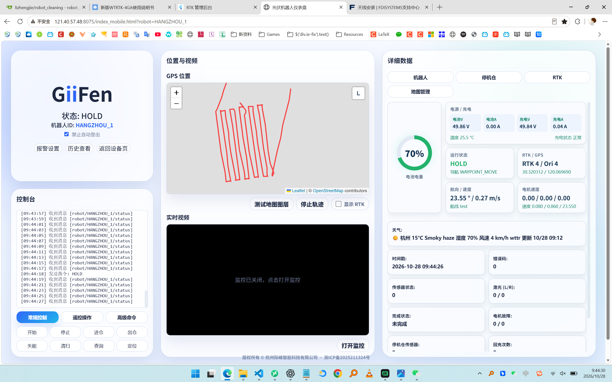

# 上周主要改动

时间范围：2026-10-26 至 2026-11-01

## 1. 磁导航进仓/出仓（调试中）

- 新增 W200B 磁导航串口节点，包含 Modbus CRC、数据帧解析和磁道误差计算。
- 将磁导航接入 `motor_control`，用于直线进仓和出仓纠偏。
- 增加磁道中心搜索、反向搜索、持续右转搜索、无信号反搜和中心稳定判定等状态机逻辑。
- 增加磁导航测试控制和 MQTT 状态发布支持。
- 当前进仓/出仓标注和相关控制逻辑仍处于现场调试阶段。
- 代表提交：`ec4cd74`、`b908d4d`、`7ffa0b5`、`ed08fa6`。

## 2. 电机过流与堵转保护

- 增加总电流保护和滚刷单电机电流保护。
- 支持 AIMotor 新反馈格式，解析实时电流、采样年龄和厂商故障码。
- 增加故障锁存、自动清除和恢复流程，并发布 MQTT 故障明细。
- 新增驱动层和保护逻辑测试。
- 代表提交：`9131de5`、`377ac25`、`7286d00`。

## 3. RTK 导航控制调整

- 移除视觉纠偏相关启动参数和逻辑，限制 RTK 转向修正幅度。
- 调整初始航向、航点间 force bearing、直线段固定航向和航向状态重置逻辑。
- 收紧 RTK 质量丢失、恢复确认和航向稳定判定时间。
- 增加导航质量、航向恢复和固定航向等契约测试。
- 代表提交：`58158fb`、`e48e79d`、`5288e92`、`cd7b62f`。

### 现场状态示意

